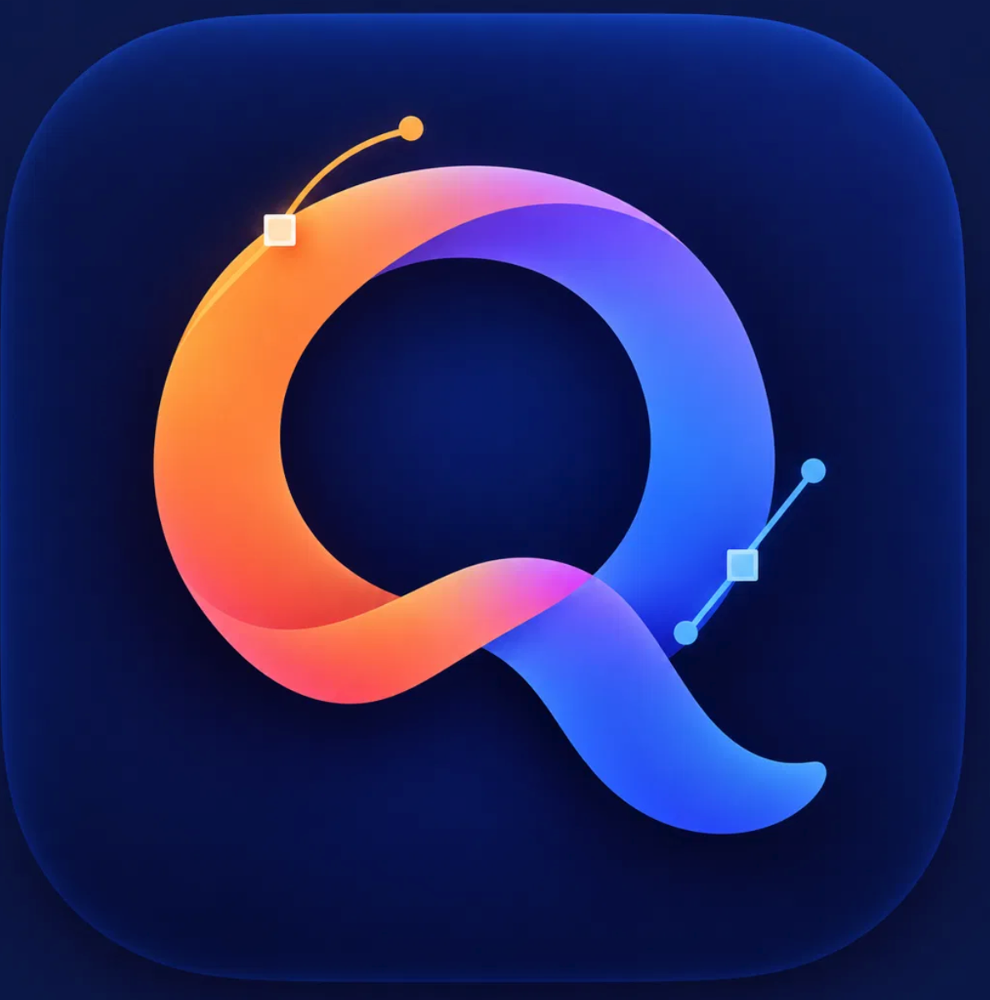
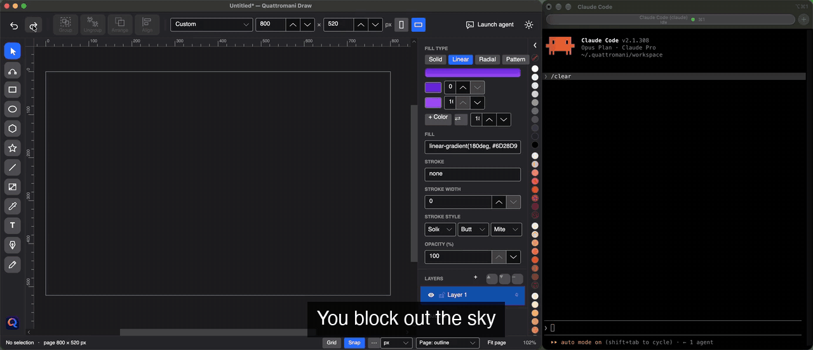
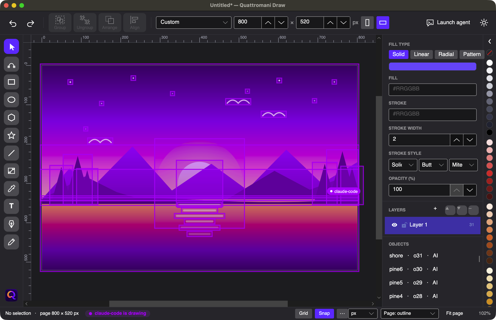

<p align="center">
  
</p>

<h1 align="center">Quattromani Draw</h1>

<p align="center">
  <strong>A vector editor you draw with — together with an AI agent.</strong><br>
  Same canvas, same document, same time. One pair of hands each.
</p>

<p align="center">
  
  
  
  
</p>

<p align="center">
  
  <br>
  <sub>Drawn by an agent through Quattromani's MCP server: 31 shapes, gradients and all, in one undo step. Not a generated bitmap — every mountain, tree and bird is an editable object.</sub>
</p>

---

## The idea

*A quattro mani* is Italian for **four hands** — the way two people play one piano. That is the whole idea of this project.

Most "AI + design" tools work like a vending machine: you type a prompt, an image comes out, and if it's not right you start over. The agent works *for* you, in a place you can't touch.

Quattromani Draw is different. It is a real vector editor — pen, nodes, gradients, layers, booleans, text on a path — in the spirit of CorelDRAW, built so that **an AI agent is a first-class collaborator on the same document you are editing**:

- You draw a rectangle. The agent sees it, and puts a sun in its top-right corner.
- The agent draws a mountain range. You grab a node and bend one peak by hand.
- The agent asks what you changed, sees your edit, and carries on from *your* version.

Nothing is thrown over a wall. Every object is a vector shape with a stable id and an optional name. Everything the agent does is undoable, and everything you do is visible to the agent.

## What it looks like

<p align="center">
  
  <br>
  <sub>A real Claude Code session, sped up (waiting time is cut ×6–×9). The human blocks out the sky, the agent builds the landscape, the human moves the sun and bends a peak, and the agent adapts to those edits. Everything it did undoes in one step.</sub>
</p>

<p align="center">
  
  <br>
  <sub>The agent's work is always visible: new and changed objects glow in the agent's color, and a label names who touched what. With several agents, each gets its own color.</sub>
</p>

## How it works

There is one document and **one command bus**. The UI never touches the document directly: you and the agent are two clients of the same bus.

```
   ┌─────────┐   mouse, keys              ┌────────────────────┐
   │  Human  │ ─────────────────────────▶ │                    │
   └─────────┘                            │    Command bus     │ ──▶ Document ──▶ Canvas
   ┌─────────┐   MCP (localhost:5577)     │  (one lock, one    │       │
   │  Agent  │ ─────────────────────────▶ │   undo stack)      │       └──▶ SVG · PDF · PNG
   └─────────┘                            └────────────────────┘
```

The rules that make this work:

- **Every command is JSON, undoable, and carries an author** (`human` or `llm:<name>`).
- **A batch is a transaction.** The agent sends several commands at once; they succeed or fail together and cost you exactly one undo step.
- **Everything is versioned.** The agent can ask *"what changed since version N?"* and see precisely what you did with the mouse.
- **Stable ids and semantic names.** `"sun"` and `"title"` are valid targets, so the agent doesn't have to juggle coordinates.
- **Relative positioning.** `rightOf`, `inside`, `alignTo`, `anchor`, `margin` — the agent says *where*, not *how many pixels*.
- **Errors that teach.** A bad call returns an explanation and a working example, so even a small model recovers on the next try.

Here is the kind of command an agent sends:

```json
{ "cmd": "shape.create", "type": "ellipse", "name": "sun",
  "rel": { "inside": "sky", "anchor": "top-right", "margin": 20 },
  "width": 80, "height": 80, "fill": "radial-gradient(#FFFBEB, #FDE68A)" }
```

## Quick start

### Download

Every [release](https://github.com/cbuzi/quattromani-draw/releases) has a self-contained package for **macOS** (Apple Silicon and Intel), **Windows** and **Linux** — no .NET install needed. Unzip and run.

> **First launch.** The packages are not code-signed yet, so your system will ask for confirmation once:
> - **macOS:** right-click `Quattromani Draw.app` → *Open* (or run `xattr -dr com.apple.quarantine "Quattromani Draw.app"`).
> - **Windows:** SmartScreen → *More info* → *Run anyway*.
> - **Linux:** `tar xzf Quattromani-Draw-*.tar.gz && ./Quattromani.App` (it needs the usual desktop libraries: X11 or Wayland, fontconfig).

### Build from source

You need the [.NET 10 SDK](https://dotnet.microsoft.com/download). Then:

```bash
git clone https://github.com/cbuzi/quattromani-draw.git
cd quattromani-draw
dotnet run --project src/Quattromani.App
```

Quattromani starts an MCP server on `http://localhost:5577/mcp` while it is open (set `QUATTROMANI_PORT` to change it).

### Bring an agent in

**The easy way:** click **Launch agent** in the top bar and pick Claude Code, Codex or OpenCode. Quattromani opens your terminal (Terminal, iTerm2, Windows Terminal, …) in a workspace folder, already connected to the running app and with instructions on how to use it. You need the agent installed and signed in; if it isn't, the terminal tells you where to get it.

**Manually:** register the server once with your agent of choice.

```bash
# Claude Code
claude mcp add --transport http quattromani http://localhost:5577/mcp

# Codex
codex mcp add quattromani --url http://localhost:5577/mcp
```

Any other MCP client works with the usual JSON config:

```json
{ "mcpServers": { "quattromani": { "type": "http", "url": "http://localhost:5577/mcp" } } }
```

Then just talk to your agent:

> *"Draw a lighthouse on a cliff at dusk, with a beam of light across the sea."*
> *"Make the sky warmer — and keep the clouds I moved."*
> *"Put a title under the lighthouse, on a curved path."*

Working with several agents at once? Each one can pass a distinct `agent` name; its work gets its own color and label.

## What you can draw

| | |
|---|---|
| **Shapes** | Rectangle (rounded corners), ellipse, polygon, star, line, Bézier paths, images |
| **Pen & nodes** | Bézier pen, freehand pencil that fits smooth curves, node editing with cusp / smooth / symmetric handles |
| **Fills & strokes** | Solid colors, multi-stop linear and radial gradients, patterns, dashes, caps, joins, per-object opacity |
| **Text** | Fonts, wrapping, alignment, **text on a path**, convert to curves |
| **Booleans** | Weld, trim, intersect, subtract |
| **Organizing** | Layers (hide / lock), groups, align & distribute, z-order, flip, guides, rulers, grid, snapping |
| **Tracing** | Import a bitmap and vectorize it into a single path |
| **Files** | Native `.quattromani` (readable JSON), **SVG** import & export, **PDF** (vector), **PNG** |
| **Safety net** | Undo / redo, autosave & crash recovery, recent files |

Light and dark themes, a modern toolbox, and a properties panel that follows your selection.

## For agent builders

The server exposes a small set of rich tools — a few calls, lots of power, with examples in the tool descriptions themselves.

| Tool | What it does |
|---|---|
| `get_document` | Compact JSON scene graph: ids, names, types, bounds, styles, layers |
| `execute` | A batch of commands = one undo step. Returns created ids and the new version |
| `render` | PNG of the document or a region, so the agent can *look* at what it drew |
| `get_changes` | Everything that changed since version N — especially what the human did |
| `get_selection` / `select` | See and set the human's selection |
| `save_document` / `open_document` / `new_document` | Documents on disk |
| `export_svg` / `export_pdf` / `export_png` | Export |
| `list_fonts` | Fonts installed on the machine |

`execute` speaks one command language: `shape.create` (rectangle, ellipse, line, polygon, star, path, text, image), `object.move / style / resize / rotate / flip / group / ungroup / duplicate / delete / order / align / distribute / place / rename / state / toLayer`, `shape.boolean`, `shape.toPath`, `path.set`, `text.set`, `text.onPath`, `rect.corner`, `image.trace`, `svg.import`, `page.set`, `layer.*`, `guide.*`. It is deliberately forgiving: it accepts the common ways models mangle the call, and its errors explain how to fix it.

## Status

Quattromani Draw is in **beta**. It is developed and used daily on **macOS**. It is built on Avalonia and Skia, so Windows and Linux are expected to work: CI builds and tests the Core on all three, but the app itself has not been exercised there yet — reports and fixes are very welcome.

Out of scope for now: CMYK and print workflows, advanced multi-page documents, AI / CDR import. On the roadmap: **Quattro-Clip**, a shape clipper that fits objects inside any shape, plus blends, contours and envelopes (all modeled as real objects, flattened on SVG export), an in-app chat panel for the agent, code-signed and notarized packages, and double-click opening of `.quattromani` files.

## Project layout

```
src/
├── Quattromani.Core   Document model, geometry, commands, undo/redo, versioning, SVG.
│                      No dependency on UI or MCP.
├── Quattromani.App    Avalonia UI: shell, Skia canvas, tools, panels.
└── Quattromani.Mcp    MCP server (HTTP, on localhost), hosted inside the app process.
tests/
└── Quattromani.Core.Tests   xUnit tests of the Core: bus, undo, layers, booleans, file formats.
scripts/package.sh           Builds the release package for one platform.
```

Stack: C# · .NET 10 · [Avalonia](https://avaloniaui.net/) 12 · [SkiaSharp](https://github.com/mono/SkiaSharp) · the official [MCP C# SDK](https://github.com/modelcontextprotocol/csharp-sdk).

## Contributing

Ideas, bug reports and pull requests are welcome — see [CONTRIBUTING.md](CONTRIBUTING.md). Run the tests with `dotnet test`. A few ground rules that keep the project coherent:

- **Everything goes through the command bus.** The UI never edits the document directly.
- Keep it simple. No premature abstractions, and no new dependency without a concrete reason.
- Don't copy GPL code (Inkscape, lib2geom…). Reading it to understand an algorithm is fine; rewrite from scratch.

## License

Copyright © 2026 Cristiano Buzi. Released under the [GNU General Public License v3.0](LICENSE): you are free to use, study, modify and share it, and modified versions you distribute must stay open source under the same license.

Need to use Quattromani Draw under different terms — for example inside a product that cannot be GPL? A separate commercial license is possible: open an issue on GitHub to get in touch.

## Inspiration

Quattromani is its own thing, but it learned from good teachers: [CorelDRAW](https://www.coreldraw.com/) for what a vector editor should feel like, [Penpot's MCP](https://penpot.app/) for how an editor can talk to agents, [Graphite](https://graphite.rs/) for a message-based editor architecture, and [Paper.js](http://paperjs.org/) and [kurbo](https://github.com/linebender/kurbo) for the geometry of Bézier curves.

*CorelDRAW is a trademark of Corel Corporation. Quattromani Draw is an independent project and is not affiliated with, endorsed by or sponsored by Corel. All other trademarks are the property of their respective owners.*
